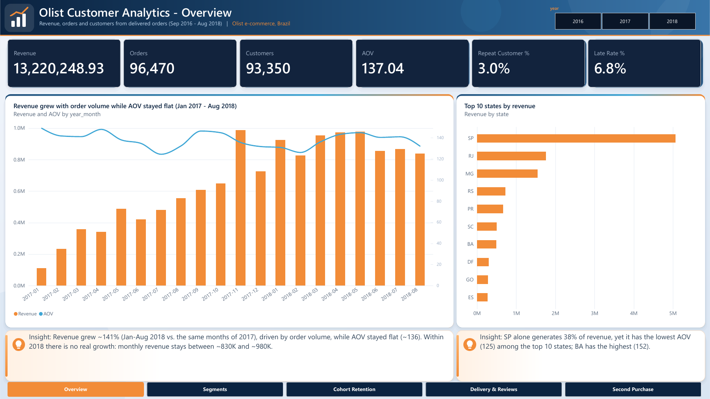
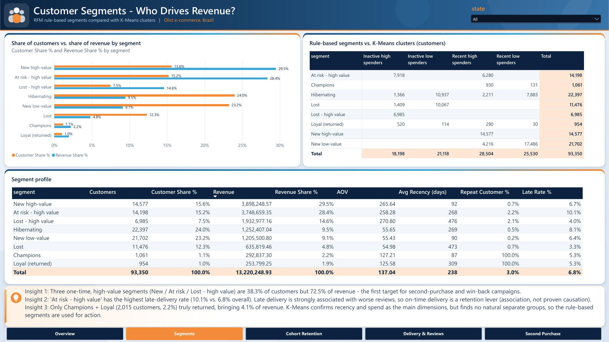
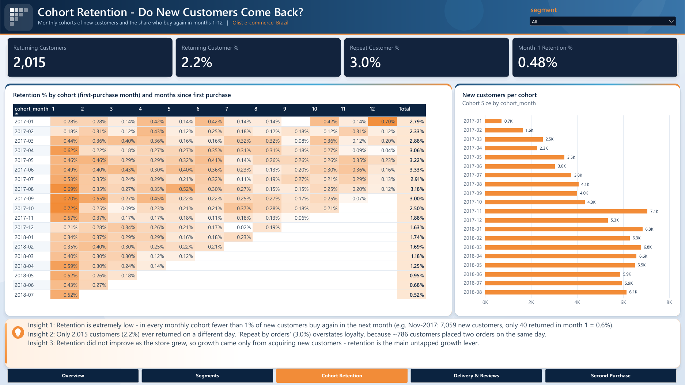
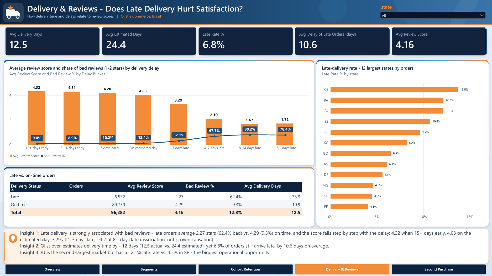
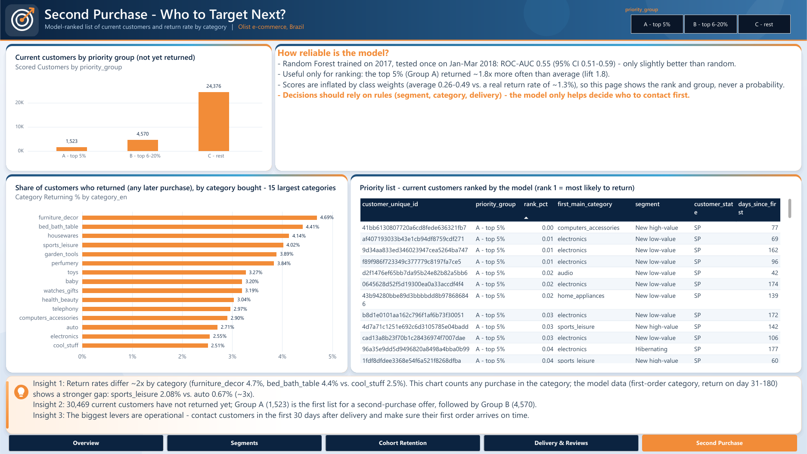

# Olist Customer Analytics — From Raw Data to Retention Strategy

**English** | [العربية](README.ar.md)

An end-to-end analytics project on **100K real orders** from Olist, a Brazilian e-commerce marketplace:
SQL data warehouse → Python analysis, segmentation and machine learning → 5-page Power BI dashboard.



---

## The business question

Olist grew fast in 2017, but revenue stopped growing in 2018.
**Why — and which customers should the business focus on to grow again?**

## Key results at a glance

| Metric | Value |
|---|---|
| Delivered orders | 96,470 |
| Revenue (product value, excl. freight) | R$ 13.22M |
| Customers | 93,350 |
| Customers who truly came back | **2.2%** (2,015) |
| Late deliveries | 6.8% |
| Avg review: late vs. on-time | **2.27 vs. 4.29** |

Every number in the dashboard is verified against SQL (check files in `powerbi/checks/`).

---

## Top 5 insights

**1. Growth came only from new customers — and then it stopped.**
Revenue grew +141% (Jan–Aug 2018 vs. 2017), driven entirely by order volume; the average order value stayed flat (~R$136). Within 2018 monthly revenue was flat (R$830K–980K).

**2. Retention is the real problem.**
Only 2.2% of customers ever bought again on a different day. In every monthly cohort, fewer than 1% return in the next month (month-1 retention: 0.48%), and newer cohorts are no better than older ones.
Note: "repeat customers by orders" (3.0%) overstates loyalty — 786 of them simply placed two orders on the same day.

**3. 38% of customers bring 72% of revenue.**
Three one-time, high-value segments (New / At risk / Lost – high value) are the first target for second-purchase and win-back campaigns. K-Means confirmed recency and spend as the two dimensions that matter, but found no natural separate groups, so rule-based RFM segments are used for action.

**4. Late delivery destroys satisfaction — step by step.**
Review score falls with every day of delay: 4.32 when 15+ days early → 4.03 on the estimated day → 3.29 at 1–3 days late → ~1.7 at 8+ days late. Customers whose first order arrived late were 35% less likely to return (z-test, p = 0.0004). *Association, not proven causation.*

**5. Rio de Janeiro is the biggest operational opportunity.**
RJ is the 2nd-largest market (13% of revenue) but has a 12.1% late rate vs. 4.5% in São Paulo. The most valuable at-risk segment also has the highest late rate (10.1%).

## Recommendations

1. **Second-purchase campaign in the first 30 days after delivery** — this is where late delivery hurts the return rate most.
2. **Prioritise the high-value one-time segments**: a second-purchase offer for *New high-value*, a win-back campaign for *At risk – high value*.
3. **Fix delivery in RJ first** and set more realistic delivery estimates (Olist over-estimates by ~12 days, yet 6.8% still arrive late).
4. **Free-shipping threshold or bundles for small orders**: for orders under R$50 (30% of orders), freight costs 46% of the product price.
5. **Use the priority list (groups A/B)** to decide *who to contact first* — not as a probability.

---

## Dashboard (Power BI)

| Page | Business question |
|---|---|
| **Overview** | How are revenue, orders and customers trending? |
| **Segments** | Which customer segments drive revenue? |
| **Cohort Retention** | Do new customers come back? |
| **Delivery & Reviews** | Does late delivery hurt satisfaction? |
| **Second Purchase** | Who should we target next? |

<table>
<tr><td></td><td></td></tr>
<tr><td></td><td></td></tr>
</table>

---

## Methodology

### 1. SQL Server — data warehouse
- Loaded 9 raw CSV files with `BULK INSERT` into a **staging** layer; row counts match the official dataset.
- **23 data-quality checks**. Key finding: `customer_id` changes with every order — the real customer is `customer_unique_id`.
- **Clean** layer with correct types and quality flags (no rows deleted).
- **Star schema** (`dw`): `FactOrders`, `FactOrderItems`, `FactPayments` + `DimCustomer`, `DimProduct`, `DimSeller`, `DimDate`, `DimGeography`.
- Analytical queries with CTEs and window functions, plus reporting **views** (`rpt`) used by Python and Power BI.

### 2. Python — analysis and machine learning
- **EDA** (`01_eda.ipynb`): growth, purchase frequency, order value and freight, delay vs. reviews, states, cohorts.
- **RFM segmentation** (`02_rfm_segmentation.ipynb`): 8 rule-based segments, compared with **K-Means** (k = 4, silhouette 0.33–0.36).
- **Second-purchase model** (`03_churn_model.ipynb`): predicts whether a customer buys again within 180 days.
  - **No data leakage:** prediction is made on day 30 after the first purchase using only information available then; time-based split (train 2017, test Jan–Mar 2018).
  - Logistic Regression vs. Random Forest, class weights for the 1:49 imbalance, evaluated with ROC-AUC / PR-AUC and lift.

### 3. Power BI — dashboard
- PBIP project (report and model stored as text files, version-controlled in Git).
- 26 documented DAX measures, star-schema relationships, custom theme.

## An honest note on the model

The final model reached **ROC-AUC 0.55** (95% CI 0.51–0.59) on 2018 data — only slightly better than random.
With information from the first order alone, a second purchase **cannot be predicted reliably**.
So the model is used only as a **ranking aid** (top 5% of customers returned ~1.8× more often than average), while business decisions rely on rules: segments, product categories and delivery.

Reporting this clearly is part of the result: knowing what the data *cannot* do prevents spending a marketing budget on false precision.

---

## Tech stack

`SQL Server` · `T-SQL` · `Python` (pandas, NumPy, scikit-learn, SciPy, matplotlib, seaborn, SQLAlchemy) · `Jupyter` · `Power BI` (DAX, PBIP) · `Git`

## Repository structure

```
olist-customer-analytics/
├── sql/          01–08: staging → cleaning → star schema → analysis → views
├── notebooks/    01 EDA · 02 RFM + K-Means · 03 second-purchase model · db_utils.py
├── powerbi/      PBIP project + checks/ (DAX verification queries)
├── images/       analysis charts + dashboard screenshots
├── tools/        export_query_results.py
└── requirements.txt
```

## How to run

1. Download the dataset from [Kaggle — Brazilian E-Commerce by Olist](https://www.kaggle.com/datasets/olistbr/brazilian-ecommerce) into `data/raw/`.
2. In SQL Server, run `sql/01` to `sql/07` in order (update the CSV path in `02_load_staging.sql`).
3. Create a Python environment and install the requirements:
   ```
   python -m venv .venv
   pip install -r requirements.txt
   ```
4. Run the notebooks `01` → `03` (notebooks 02 and 03 write the results to the `ml` schema), then run `sql/08_ml_views.sql`.
5. Open `powerbi/olist_customer_analytics.pbip` in Power BI Desktop and refresh (server: `localhost\SQLEXPRESS`, database: `OlistDB`).

## Data

[Brazilian E-Commerce Public Dataset by Olist](https://www.kaggle.com/datasets/olistbr/brazilian-ecommerce) — about 100K orders from 2016 to 2018. Raw data is not included in this repository.

---

**Mohammed Altatari** — Data Analyst (SQL · Power BI · Python)
[GitHub](https://github.com/MohammedAltatari)
